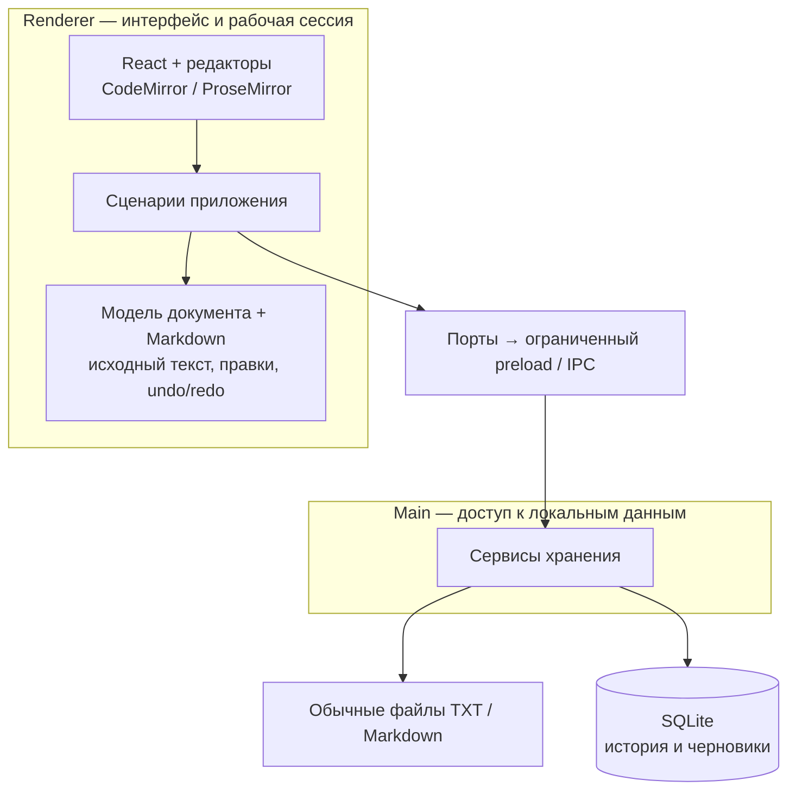

# Упрощённая диаграмма архитектуры

Десктопная версия. Схема кратко отражает [архитектурную спецификацию](spec-architecture.md), не вводя новых решений.

**Главный принцип:** исходный текст — основа документа; оба редактора используют одну сессию и общую историю правок.
